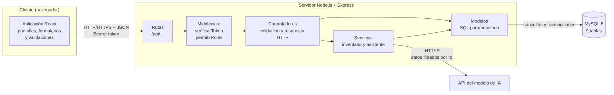

# 5. Arquitectura Del Sistema De FerroGest

Introducción

En este documento se describe la arquitectura de sistema que se utilizó en FerroGest, un sistema de información web para la gestión de ventas e inventario de una ferretería, con un asistente conversacional con inteligencia artificial. Primero se explica qué es una arquitectura de sistema, luego se comparan los tipos más comunes y, por último, se describe la arquitectura elegida y se justifica esa decisión con las características del software.\
¿Qué es una arquitectura de sistema?\
La arquitectura de un sistema es una descripción breve y manejable de cómo se organiza el sistema y de qué manera interactúan sus componentes. Como los sistemas con requisitos parecidos suelen resolverse con una arquitectura similar, esta también permite reutilizar soluciones que ya han funcionado en otros proyectos.

Elegir la arquitectura al comienzo del proyecto es importante porque condiciona cómo se construirá, se probará y se desplegará el sistema, y porque cambiarla más adelante es costoso. En una metodología en cascada, como la que siguió este proyecto, la decisión se toma antes de la implementación.

Tipos de arquitectura&#x20;

Se compararon tres opciones frecuentes para aplicaciones web:

&#x20;Arquitectura Descripción Ventajas Desventajas&#x20;

Monolítica Una única base de código y una única unidad de despliegue ejecutan todas las funciones del negocio. Una variante es el monolito modular, que organiza ese código en módulos con responsabilidades separadas. Sencilla de desarrollar, probar y desplegar; las transacciones son simples porque hay una sola base de datos. Para escalar hay que escalar toda la aplicación; cualquier cambio obliga a desplegar todo; si no se ordena bien, el código se acopla.

&#x20;Cliente-servidor en capas El sistema se divide en un cliente, que es la interfaz, y un servidor, que es la lógica y los datos. El servidor suele organizarse en capas: presentación, lógica de negocio y acceso a datos. Separa claramente las responsabilidades; el cliente y el servidor pueden evolucionar por separado. Depende de la red; exige definir bien cómo se comunican las partes.&#x20;

Microservicios El sistema se divide en servicios pequeños e independientes, cada uno con su propia lógica y, normalmente, su propia base de datos, que se comunican por la red. Cada servicio se escala y se despliega por separado; un fallo queda aislado en un servicio. Mucha más complejidad operativa; las transacciones entre servicios son difíciles. Requiere más infraestructura y experiencia.&#x20;

Arquitectura elegida para FerroGest FerroGest utiliza una arquitectura cliente-servidor en capas, con un backend monolítico modular. Es decir, la interfaz (frontend) está separada del servidor, y el servidor (backend) es una sola aplicación, con una única base de código y un único despliegue, organizada internamente en módulos y en capas. Aunque en la arquitectura monolítica pura la interfaz, la lógica del negocio y el acceso a los datos forman un solo bloque, en FerroGest lo monolítico es el backend, mientras que el frontend en React se mantiene como una aplicación aparte que se comunica con él.&#x20;

Componente Tecnología Responsabilidad

&#x20;Frontend (cliente) React, en el navegador Muestra las pantallas, valida los formularios y se comunica con el backend. Es la capa de vista.&#x20;

Backend (servidor) Node.js, con arquitectura MVC Contiene la lógica del negocio, la autenticación, el control de acceso por rol y el acceso a los datos. Está organizado en módulos —autenticación, usuarios, productos, categorías, inventario, clientes, ventas, dashboard y asistente de IA— y en cuatro capas: rutas, controladores, servicios y modelos.&#x20;

Base de datos MySQL Almacena toda la información del sistema y garantiza su consistencia mediante transacciones.&#x20;

API del modelo de IA Servicio externo Redacta las respuestas del asistente a partir de los datos que le entrega el backend. Diagrama de la arquitectura

El funcionamiento general es el siguiente: el usuario accede desde el navegador, el frontend envía peticiones HTTP/HTTPS con datos en formato JSON al backend, el backend valida el token de sesión y el rol, ejecuta la lógica del negocio y consulta MySQL. Cuando el usuario escribe al asistente de IA, el backend obtiene primero los datos que el rol del usuario puede consultar y solo entonces envía esa información al modelo de IA para que redacte la respuesta.&#x20;

Justificación



Tamaño del equipo y del plazo&#x20;

El proyecto lo desarrollaron cuatro personas en unas siete semanas, con metodología en cascada. Una sola base de código es más fácil de coordinar, probar y entregar que varios servicios independientes.



Carga pequeña FerroGest está pensado para una ferretería pequeña: alrededor de 10 cuentas de usuario, con 3 usuarios conectados al mismo tiempo, hasta 1.000 productos, 2.000 clientes y unas 100 ventas diarias. No necesita escalar partes por separado, que es la principal ventaja de los microservicios.



Consistencia de los datos&#x20;

Registrar una venta y descontar el stock debe ocurrir como una sola operación: si una parte falla, no se guarda ninguna. Con un solo backend y una sola base de datos, una transacción de MySQL lo resuelve de forma directa; con microservicios habría que coordinar varios servicios.



Seguridad centralizada&#x20;

El control de acceso por rol y la clave de la API de IA se manejan en un solo punto: el servidor. La clave nunca se envía al navegador.



Compatibilidad con MVC&#x20;

El monolito modular se organiza de forma natural en rutas, controladores, servicios y modelos, con React como capa de vista.



Posibilidad de evolucionar

&#x20;Al estar organizado por módulos, alguno de ellos podría separarse más adelante si la carga crece.



Ventajas y desventajas&#x20;

Ventajas&#x20;

Desarrollo y pruebas más rápidos, con una sola base de código.&#x20;

Transacciones simples y datos consistentes.

&#x20;Despliegue único y depuración más sencilla.

&#x20;Separación clara de responsabilidades entre interfaz, lógica y datos.&#x20;

Desventajas Para escalar hay que escalar todo el backend, no solo un módulo.&#x20;

Un error grave en el backend puede afectar a todos los módulos.&#x20;

Cualquier cambio obliga a volver a desplegar toda la aplicación.

&#x20;El asistente de IA depende de un servicio externo: si no está disponible o la clave no está configurada, el sistema muestra un aviso y el resto de las funciones sigue operando.&#x20;

Conclusión Para FerroGest se eligió una arquitectura cliente-servidor en capas con un backend monolítico modular, porque es la que mejor equilibra la sencillez de construcción, la consistencia de los datos y el costo con las necesidades reales del proyecto: un equipo pequeño, un plazo corto y una carga moderada. Además, permitió aplicar el patrón MVC y deja abierta la posibilidad de evolucionar hacia una arquitectura más distribuida si el sistema crece.

&#x20;Referencias

&#x20;https://www.google.com.co/books/edition/Ingenier%C3%ADa%5Fde%5FSoftware/BU-CEQAAQBAJ?hl=es-419\&gbpv=1\&dq=Tipos+de+arquitectura+de+sistemas+monoliticas+microservicios+cliente+servidor\&pg=PT87\&printsec=frontcover https://gc.scalahed.com/recursos/files/r161r/w25469w/ingdelsoftwarelibro9%5Fcompressed.pdf https://keepcoding.io/blog/aplicaciones-monoliticas-vs-microservicios/ https://www.mentorestech.com/resource-blog-content/arquitectura-modular-monolitica https://www.netmentor.es/entrada/monolito-modular
